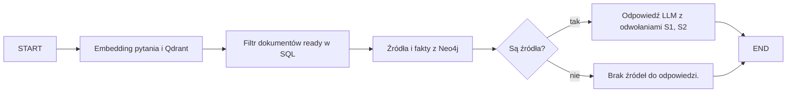

# AI: LangGraph, Ollama, Neo4j i Qdrant

Template zawiera backend do indeksowania tekstowych źródeł i zadawania pytań na
ich podstawie. Lokalnie używa Ollamy, Neo4j Community i Qdrant. Konfiguracja dla
Vercel wskazuje zewnętrzne usługi; funkcja nie uruchamia modeli ani baz danych.

## Podział odpowiedzialności

| Element             | Rola                                                                           |
| ------------------- | ------------------------------------------------------------------------------ |
| PostgreSQL / SQLite | Rejestr indeksowania `ai_index_records`, statusy i idempotencja                |
| Ollama              | Lokalny model rozmowy `qwen3:0.6b` i embeddingi `embeddinggemma`, 768 wymiarów |
| Qdrant              | Embeddingi fragmentów i wyszukiwanie podobnych źródeł                          |
| Neo4j               | Graf źródeł, graf wiedzy i powiązania wskazujące dowody                        |
| LangGraph           | Ograniczony przepływ jednego zapytania                                         |

Qdrant ma osobną odpowiedzialność od Neo4j: wyszukuje fragmenty semantycznie,
a Neo4j dostarcza ich tekst, fakty i pochodzenie. Ten podział pozwala używać
lokalnie tych samych adapterów co z AuraDB i Qdrant Cloud. Nie wymaga APOC, GDS
ani funkcji Neo4j Enterprise.

### Wybór baz

Wybrano **Neo4j Community / AuraDB Free + Qdrant** dla tego szkieletu:

| Wariant wektorów | Ocena dla tego projektu                                                                                                                                                          |
| ---------------- | -------------------------------------------------------------------------------------------------------------------------------------------------------------------------------- |
| Qdrant           | Osobny magazyn wektorów, filtrowanie payloadu i ten sam REST lokalnie oraz w chmurze. Wybrane darmowe embeddingi chmurowe pozwalają uniknąć pobierania modelu do funkcji Vercel. |
| Weaviate         | Ma obecnie plan Free Forever, więc jest realną alternatywą. Limit jednej kolekcji i trzech tenantów ogranicza jednak równoległe profile embeddingów i rozwój tego szkieletu.     |
| pgvector         | Mniej usług, jeśli priorytetem jest jeden PostgreSQL. Wymaga obsługi rozszerzenia przez wybrany hosting; ten projekt udostępnia osobny adapter bazy wektorowej.                  |

To wybór do tych wymagań, bez deklaracji przewagi wydajności bez benchmarku.
Neo4j przechowuje oba logiczne grafy w jednej bazie, co mieści się w modelu
AuraDB Free. Weaviate nie zostało odrzucone z powodu braku darmowego hostingu:
aktualny plan obejmuje 100 000 obiektów i 2000 wywołań embeddingów dziennie.
[Weaviate Free](https://docs.weaviate.io/cloud/manage-clusters/create),
[Qdrant Cloud Inference](https://qdrant.tech/documentation/inference/cloud-inference/),
[pgvector](https://github.com/pgvector/pgvector).

### Dual graph

Oba grafy są logicznymi częściami **jednej bazy Neo4j**:

- Graf źródeł: `Document -[:HAS_CHUNK]-> Chunk`, kolejność fragmentów przez `NEXT`.
- Graf wiedzy: `Entity -[:SUBJECT_OF]-> Claim -[:OBJECT]-> Entity`; `Claim`
  przechowuje predykat oraz dowód.
- Połączenie grafów: `Claim -[:SUPPORTED_BY]-> Chunk` oraz
  `Chunk -[:MENTIONS]-> Entity`.

Każdy fakt ma wskazany dokument i fragment zawierający jego dowód. Nazwy encji,
typy encji i relacje są danymi przekazywanymi jako parametry Cypher; model nie
generuje zapytań do bazy.

### LangGraph

Graf wykonania LangGraph jest niezależny od obu grafów danych w Neo4j:



Każde zapytanie tworzy osobny `StateGraph`, bez checkpointera, historii rozmów
i współdzielonego stanu w pamięci procesu. Retrieval pobiera maksymalnie osiem
fragmentów. Weryfikuje status SQL, namespace oraz zgodność identyfikatorów
dokumentu i fragmentu przed użyciem danych Neo4j. Fakty muszą wskazywać pobrany
fragment i mieć dowód obecny w jego treści. Brak dostępnych źródeł pomija LLM.

Prompt traktuje źródła i fakty jako niezaufane dane oraz instruuje model, aby
cytował dostępne odwołania `[S1]`, `[S2]`. Lista `sources` pochodzi z pobranych
fragmentów. Walidacja odrzuca identyfikatory cytowań spoza tej listy, ale nie
potwierdza poprawności twierdzeń ani tego, czy cytowane źródło wspiera konkretną
odpowiedź. Model może popełnić błąd; instrukcje promptu nie gwarantują odporności
na prompt injection. Trwała pamięć rozmów jest możliwym rozszerzeniem, ale nie
jest zaimplementowana. Zobacz
[LangGraph overview](https://docs.langchain.com/oss/python/langgraph/overview)
i [persistence](https://docs.langchain.com/oss/python/langgraph/persistence).

## Uruchomienie lokalne

Uruchomienie całego stosu z katalogu głównego projektu:

```sh
make up
```

Compose utrzymuje PostgreSQL, Ollamę, Neo4j, Qdrant, API i frontend oraz uruchamia
migrację SQL i jawne zadania inicjalizacyjne. Pierwsze uruchomienie wymaga
pobrania modeli Ollamy. Gotowość kontenerów nie oznacza, że pierwszy przebieg
modelu na CPU będzie szybki; mały `qwen3:0.6b` jest ustawieniem startowym.

Tworzenie constraintów Neo4j i kolekcji/indeksów Qdrant należy do osobnego
zadania `ai-init`, a nie do importu aplikacji ani obsługi requestu. To zadanie
można powtórzyć po zmianie konfiguracji. SQL nadal migruje Alembic.

```sh
make ai-init
make ai-smoke
```

`make ai-init` wykonuje `docker compose run --rm ai-init`. `make ai-smoke`
sprawdza indeksowanie i query działającego lokalnego stosu. `make up` czeka
na gotowość usług do 1200 sekund; pobranie modeli zależy od łącza i pierwszego
startu wolumenów.

Smoke test zachowuje jeden dokument w namespace `template_smoke`, aby można
było powtarzać sprawdzenie idempotencji. Adres można zmienić przez
`AI_SMOKE_BASE_URL`. Niezależne testy prawdziwych adapterów sprzątają swoje
kolekcje i namespace'y; uruchamiaj je wyłącznie na lokalnych usługach:

```sh
cd api
AI_INTEGRATION=1 uv run pytest --no-cov tests/test_ai_integration.py
```

Adresy domyślne: frontend `http://localhost:8080`, API `http://localhost:8000`,
OpenAPI `http://localhost:8000/docs`. Zmienne portów i ustawienia serwisów
pochodzą z Compose. `make down` zatrzymuje stos i zachowuje wolumeny.

Jeżeli natywna Ollama zajmuje port 11434, ustaw `OLLAMA_PORT=11435` w głównym
`.env`. Zmienia to tylko mapowanie portu hosta; API w Compose nadal używa
wewnętrznego adresu serwisu Ollama.

Poza Compose AI jest opt-in: ustaw `APP_AI_ENABLED=true` oraz endpointy
z [api/.env.example](../api/.env.example). Sama aplikacja nie pobiera modeli.

## REST API

### Zapis źródła

`PUT /api/v1/ai/documents/{document_id}` przyjmuje UUID wybrany przez klienta.
Poniższy request można bezpiecznie ponowić z tym samym identyfikatorem i body:

```sh
curl --fail-with-body -X PUT \
  http://localhost:8000/api/v1/ai/documents/2858d175-04dd-43a5-a695-cc91a78bc493 \
  -H 'Content-Type: application/json' \
  -d '{
    "namespace": "demo",
    "title": "Stolica Polski",
    "text": "Warszawa jest stolicą Polski.",
    "facts": [{
      "subject": {"name": "Warszawa", "kind": "city"},
      "predicate": "capital_of",
      "object": {"name": "Polska", "kind": "country"},
      "evidence": "Warszawa jest stolicą Polski."
    }]
  }'
```

`facts` jest opcjonalne. Pustą listą można indeksować samo źródło. Template
**nie wykonuje automatycznej ekstrakcji encji ani relacji przez LLM**.
Wywołujący dostarcza fakty i dokładny cytat `evidence`, który musi występować
w `text`. Dowód oznacza pochodzenie stwierdzenia, nie niezależne potwierdzenie
jego prawdziwości.

Tekst ma maksymalnie 12 000 znaków, lista zawiera najwyżej 32 fakty, a dowód
ma maksymalnie 200 znaków. Fragmenty mają po 1000 znaków z zakładką 200 znaków;
każdy dowód mieści się w co najmniej jednym fragmencie. Identyfikatory
fragmentów, encji i faktów są deterministyczne.

Odpowiedź zawiera `document_id`, `namespace`, `status`, `chunk_count` i
`collection`. Udany zapis ma status `ready`.

### Status

Status dokumentu w aktywnej kolekcji:

```sh
curl --fail-with-body \
  'http://localhost:8000/api/v1/ai/documents/2858d175-04dd-43a5-a695-cc91a78bc493?namespace=demo'
```

`GET /api/v1/ai/status` pokazuje, czy AI jest włączone, dostawców, nazwy modeli
i aktywną kolekcję. Ten endpoint nie odpytuje zewnętrznych usług i nie jest
testem ich dostępności.

### Pytanie

```sh
curl --fail-with-body -X POST http://localhost:8000/api/v1/ai/query \
  -H 'Content-Type: application/json' \
  -d '{"namespace":"demo","question":"Co jest stolicą Polski?","limit":4}'
```

Odpowiedź zawiera `answer`, `sources` oraz pobrane `facts`. Każde źródło ma
`reference`, `chunk_id`, `document_id`, `title` i `text`. Pytanie może mieć
maksymalnie 2000 znaków, a `limit` wynosi od 1 do 8, domyślnie 4.

## Spójność i ponawianie indeksowania

Rejestr SQL jest kluczowany przez `(namespace, document_id, collection)`.
Przechowuje hash kanonicznego body, profil embeddingów, liczbę fragmentów
i status. Przebieg zapisu:

1. Rezerwacja i commit statusu `pending` w SQL.
2. Embeddingi i upsert fragmentów w Qdrant.
3. Transakcyjny zapis obu grafów i ich powiązań w Neo4j.
4. Commit statusu `ready` w SQL.

To koordynacja trzech magazynów, bez rozproszonej transakcji. Awaria może
pozostawić wektory lub dane grafu bez ukończonego wpisu SQL. Retrieval używa
wyłącznie dokumentów `ready`, więc nie korzysta z takich częściowych zapisów.

- Ten sam UUID i identyczne body po `ready` zwracają zapisany status bez
  ponownego wywoływania modeli i baz zewnętrznych.
- Inne body pod istniejącym identyfikatorem zwraca `409`. Do nowej treści użyj
  nowego UUID. Dotyczy to także zmian tytułu lub listy faktów.
- Awaria indeksowania ustawia `failed`; przechowywany kod błędu nie zawiera
  odpowiedzi dostawcy ani danych dostępowych. Request zwraca `503`.
- Timeout lub anulowanie może pozostawić `pending`. Powtórz ten sam `PUT`
  z identycznym body, aby dokończyć indeksowanie.
- Równoległe identyczne zapisy korzystają z deterministycznych upsertów.
  Późniejsza awaria nie nadpisuje statusu `ready` statusem `failed`.

Nie ma kolejki, automatycznego retry w tle ani endpointu usuwania dokumentów.
Oryginały źródeł powinny pozostać dostępne do ponownego indeksowania.

## Vercel i usługi zewnętrzne

Punktem wyjścia jest [api/.env.vercel.example](../api/.env.vercel.example).
W projekcie backendu Vercel ustaw Root Directory na `api`, a w projekcie
frontendu na `web`. Sekrety i adresy z przykładu wprowadź jako zmienne projektu
backendu. CORS ustaw na faktyczny adres frontendu.

Potrzebne są: zewnętrzny PostgreSQL, token i identyfikator konta Cloudflare,
adres/klucz Qdrant Cloud oraz URI/login/hasło AuraDB. SQLite nie jest trwałym
magazynem dla wdrożenia Vercel. PostgreSQL można uruchomić na Neon Free;
użyj połączenia pooled w runtime oraz direct do migracji, jeśli wymaga tego
konfiguracja projektu. Migracje SQL i inicjalizację grafu/kolekcji
uruchom jawnie w środowisku z tymi samymi zmiennymi, przed ruchem aplikacyjnym:

```sh
cd api
uv run --locked alembic upgrade head
uv run --locked python -m app.platform.ai.setup
```

Komendy czytają zmienne procesu oraz lokalny `.env`; plik
`.env.vercel.example` jest wzorem, nie jest automatycznie ładowany.
Nie umieszczaj uzupełnionych sekretów w repozytorium. Funkcja Vercel łączy się
z zewnętrznymi usługami przez HTTPS i szyfrowany protokół Neo4j. Limit operacji
AI jest domyślnie ustawiony na 45 sekund; długi import dokumentów wymaga
osobnego workera zamiast pracy po zakończeniu requestu.

### Darmowe plany

Warunki sprawdzono 17 listopada 2026. Są przeznaczone do małego wdrożenia
i prototypowania; konfiguracja nie gwarantuje niezmiennych limitów dostawców.

| Usługa                     | Konfiguracja i aktualne ograniczenia                                                                                                                                                                                                                                                                                                                                                    |
| -------------------------- | --------------------------------------------------------------------------------------------------------------------------------------------------------------------------------------------------------------------------------------------------------------------------------------------------------------------------------------------------------------------------------------- |
| Neon Free                  | PostgreSQL; plan bez opłat ma limity storage, compute i transferu oraz usypianie compute. Aktualizacja z października 2026 zwiększyła storage do 1 GB na projekt. [Plan Free](https://neon.com/blog/neon-free-plan-1-gb-per-project), [cennik](https://neon.com/pricing).                                                                                                               |
| Cloudflare Workers AI Free | Chat przez OpenAI-compatible API, np. `@cf/meta/llama-3.1-8b-instruct`; 10 000 neuronów dziennie bez opłat. Po wykorzystaniu puli Free kolejne operacje kończą się błędem. Część modeli wymaga płatnego rozliczania. [Cennik](https://developers.cloudflare.com/workers-ai/platform/pricing/), [API](https://developers.cloudflare.com/workers-ai/configuration/open-ai-compatibility/) |
| Neo4j AuraDB Free          | Jedna baza dla obu grafów; do 200 000 węzłów i 400 000 relacji. Pauza po 72 godzinach bezczynności, usunięcie po ponad 30 dniach pozostawania w pauzie. [Limity](https://neo4j.com/docs/aura/quotas-and-limits/), [pauza i wznowienie](https://neo4j.com/docs/aura/managing-instances/instance-actions/)                                                                                |
| Qdrant Cloud Free          | Jeden węzeł, 1 GB RAM, 0,5 vCPU i 4 GB dysku. Zawieszenie po tygodniu bezczynności, usunięcie po czterech tygodniach, jeśli klaster nie zostanie reaktywowany. [Warunki klastra](https://qdrant.tech/documentation/cloud/create-cluster/)                                                                                                                                               |
| Qdrant Cloud Inference     | `intfloat/multilingual-e5-small`, 384 wymiary, jest oznaczony jako Free i działa również na darmowym klastrze. Tekst jest embedowany przez Qdrant, bez lokalnego modelu w funkcji Vercel. [Modele i warunki](https://qdrant.tech/documentation/embeddings/qdrant-cloud-inference/)                                                                                                      |

Lokalna Ollama korzysta z własnego sprzętu. Ollama Cloud rozlicza inference
za tokeny; plan z abonamentem `$0` nie oznacza darmowych wywołań modeli.
[Aktualny cennik Ollamy](https://ollama.com/pricing).

Cloud Inference trzeba włączyć w panelu klastra Qdrant i wybrać model oznaczony
jako Free. Dla E5 serwis automatycznie dodaje prefiksy `passage:` przy upsercie
i `query:` przy wyszukiwaniu. Dłuższe teksty i upserty mogą trafiać do osobnego
serwisu inference; region klastra nie jest gwarancją regionu każdego obliczenia.
[Konfiguracja i przetwarzanie Qdrant](https://qdrant.tech/documentation/inference/cloud-inference/).

Nie wykonywano testów na rzeczywistych kontach Cloudflare, AuraDB ani Qdrant
Cloud. Ten wariant opisuje konfigurację i kontrakty adapterów; po utworzeniu
własnych zasobów trzeba wykonać inicjalizację i sprawdzić zapis oraz query.

### Zmiana embeddingów

Profil ma postać `provider:model:dimensions` i jest sprawdzany zarówno w SQL,
jak i w filtrze Qdrant. Lokalnie jest to domyślnie
`ollama:embeddinggemma:768`, a przykład Vercel używa
`qdrant_cloud:intfloat/multilingual-e5-small:384`.

Zmiana dostawcy, modelu lub wymiarów wymaga nowej kolekcji i ponownego
indeksowania źródeł. Sama zgodność liczby wymiarów nie oznacza zgodnej
przestrzeni wektorowej. Przykłady rozdzielają kolekcje:
`app_chunks_ollama_v1` oraz `app_chunks_cloud_e5_v1`.

Ustaw nowy `APP_AI_QDRANT_COLLECTION`, odpowiedni model i wymiary, wykonaj
inicjalizację, a następnie powtórz `PUT` oryginalnych dokumentów. Nowa kolekcja
ma własne wpisy rejestru SQL; identyczne dokumenty mogą zachować UUID i graf
źródeł. Zmiana profilu w istniejącym wpisie nie zastępuje reindeksacji.

## Granice szkieletu

Template nie implementuje uwierzytelniania ani autoryzacji AI. `namespace`
porządkuje dane i filtruje zapytania, ale klient może podać jego wartość:
**nie jest granicą uprawnień**. Przed udostępnieniem danych wielu użytkownikom
aplikacja musi wiązać namespace z uwierzytelnionym użytkownikiem lub organizacją.

Logi i lokalne quality gates pozostają częścią aplikacji. Przebiegi AI jawnie
wyłączają tracing LangSmith także przy włączonych zmiennych tracingu hosta;
Eksport operacji AI do Langfuse jest konfigurowany oddzielnie i nie włącza LangSmith. Sam pakiet `langsmith` jest
zależnością przechodnią LangGraph. Zobacz
[sterowanie tracingiem](https://docs.langchain.com/langsmith/trace-without-env-vars).
Compose wyłącza raportowanie użycia, Fleet Manager, discovery i telemetrię
klientów Neo4j; sterownik ma `telemetry_disabled=True`. Qdrant ma
`QDRANT__TELEMETRY_DISABLED=true`, a Ollama `OLLAMA_NO_CLOUD=1`.
[Neo4j settings](https://neo4j.com/docs/operations-manual/current/configuration/configuration-settings/),
[telemetria sterownika](https://neo4j.com/docs/python-manual/current/connect-advanced/#disable-telemetry).

## Langfuse

Langfuse zapisuje powiązane operacje ingest i query oraz ich etapy. Domyślnie
zapisuje metadane, nazwy modeli, czasy i typy błędów. Treści wymagają jawnego
włączenia. Eksport jest ograniczony czasowo i nie blokuje poprawnej odpowiedzi
AI przy awarii. `make langfuse-smoke` sprawdza faktyczny przepływ aż do odczytu
obserwacji przez aktualne API Langfuse v2. [Instrukcja](langfuse.md).
